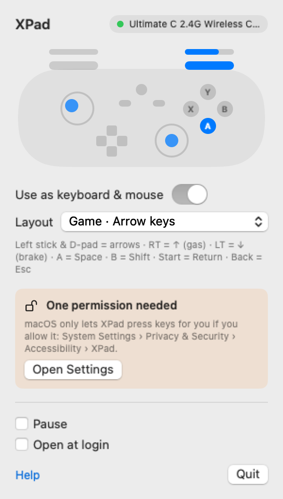

<p align="center"></p>

<h1 align="center">XPad for Mac</h1>

<p align="center"><b>Use an Xbox 360‑style (XInput) controller on your Mac.</b><br>
Free menu bar app · no driver · no kernel extension · no SIP changes · Apple Silicon & Intel</p>

<p align="center"><a href="https://github.com/OGskrrt/XPad-for-Mac/releases/latest/download/XPad.dmg"><b>⬇ Download XPad.dmg</b></a> · <a href="https://ogskrrt.github.io/XPad-for-Mac/">Website</a> · <a href="https://ogskrrt.github.io/XPad-for-Mac/tr/">Türkçe</a></p>

<p align="center"></p>

**XPad for Mac** is a free, open-source macOS app that makes Xbox 360-style USB controllers work on a Mac. These controllers (and their 2.4 GHz USB receivers) use Microsoft's XInput protocol, which macOS has no driver for, so they are not detected by games, browsers or Steam. XPad reads the controller directly over USB from user space and turns it into keyboard and mouse input that every app understands.

## Why doesn't my controller work on Mac?

macOS only supports game controllers that speak standard HID, plus Xbox One/Series, PlayStation and MFi controllers. Xbox 360 controllers and many third-party pads in "X-input" mode (for example the **8BitDo Ultimate C 2.4G** receiver) use a vendor-specific USB protocol. The Mac sees the device in System Information but nothing can use it. The old fix, the 360Controller kernel extension, is no longer maintained and does not run on Apple Silicon without lowering system security. XPad needs none of that.

## How to install

1. [Download XPad.dmg](https://github.com/OGskrrt/XPad-for-Mac/releases/latest/download/XPad.dmg) and drag **XPad** into **Applications**.
2. Open it. macOS says it can't verify the app, because XPad is free and not paid-signed by Apple. Click **Done**, open **System Settings › Privacy & Security**, scroll down and click **Open Anyway**. You only do this once.
3. Plug in your controller or its USB receiver and switch the controller on. The menu bar icon fills in and the panel shows your buttons live.
4. To play, turn on **Use as keyboard & mouse** and allow XPad in **System Settings › Privacy & Security › Accessibility**.

## Layouts

| Layout | Sticks | Buttons |
|---|---|---|
| **Game · Arrow keys** (default) | Left stick and D-pad = arrow keys | RT = ↑ (gas), LT = ↓ (brake), A = Space, B = Shift, X = Z, Y = X, LB = Q, RB = E, Start = Return, Back = Esc |
| **Game · WASD + mouse** | Left stick = WASD, right stick = mouse | RT = left click, LT = right click, A = Space, B = C, X = R, Y = E, LB = Q, RB = F, L3 = Shift, R3 = V, Start = Esc, Back = Tab |
| **Desktop · Mouse** | Left stick = mouse, right stick = scroll | A = click, B = right click, X = Space, LB/RB = back/forward (⌘[ / ⌘]), Start = Return, Back = Esc |

## FAQ

**Which controllers work?**
Any USB controller or receiver that uses the Xbox 360 (XInput) protocol: wired Xbox 360 controllers and third-party pads in X-input mode. Tested with the 8BitDo Ultimate C 2.4G. Xbox One/Series, PlayStation and Switch Pro controllers already work on macOS without XPad.

**Does it work on Apple Silicon (M1, M2, M3, M4)?**
Yes. XPad is a universal app for Apple Silicon and Intel Macs running macOS 13 Ventura or later.

**Do I need to disable SIP or install a kernel extension?**
No. XPad talks to the controller from user space using Apple's IOUSBHost framework. Nothing is installed into the system.

**Why does it need Accessibility permission?**
macOS only lets an app press keys and move the mouse for you with that permission. XPad uses it for nothing else, and it has no network access or analytics.

**Does it work with Steam or the controller settings in games?**
XPad turns the controller into keyboard and mouse input, so games see a keyboard, not a gamepad. Analog steering becomes key presses. Showing a true virtual gamepad needs a special entitlement from Apple; it may come later.

**My controller is "in use by Google Chrome".**
Only one app can use a USB controller at a time. Close the other app (or the browser tab that uses it) and XPad connects by itself. Use **Pause** in XPad to free the controller for another app.

**Is it really free?**
Yes, free and open source under the MIT license. There are no ads, accounts or in-app purchases.

## Build from source

```bash
git clone https://github.com/OGskrrt/XPad-for-Mac.git
cd XPad-for-Mac
scripts/build.sh 1.0.0   # → dist/XPad.app and dist/XPad.dmg
```

Requires Xcode 15 or later. `dist/XPad.app/Contents/MacOS/XPad --selftest 20` prints raw controller input in the terminal for 20 seconds.

## License

MIT. Not affiliated with Microsoft, Xbox or 8BitDo; product names are used only to describe compatibility.
